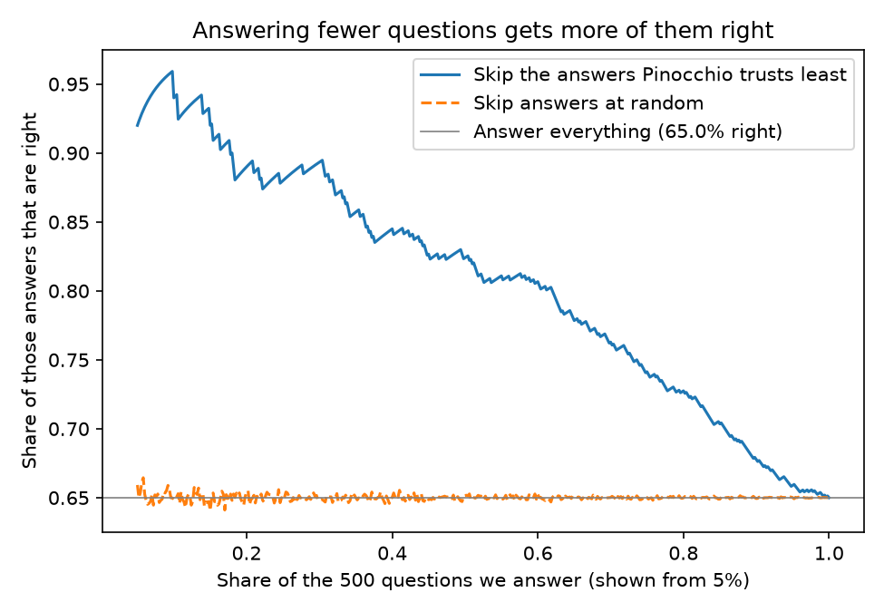
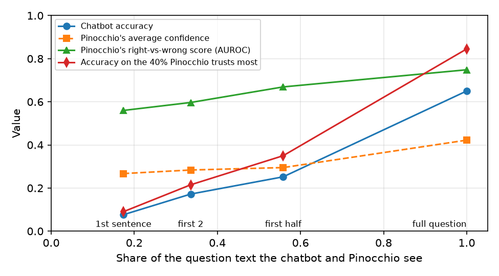
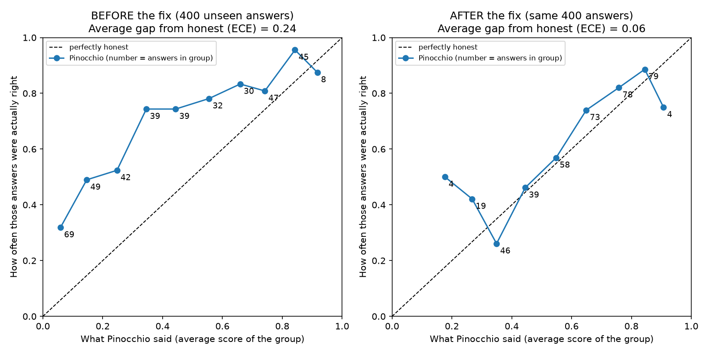

# Pinocchio on QANTA: does its confidence help skip wrong answers?

## Summary
I asked a small chatbot (Qwen2.5-3B) 500 quiz-bowl questions from QANTA, and it got 65% right. Pinocchio then read each question and answer and gave a confidence score, without ever seeing the correct answer. Its scores are useful on full questions: if the chatbot answers only the 40% of questions Pinocchio trusts most, accuracy rises from 65% to 84.5%. But Pinocchio needs enough of the question to work. After only the first sentence the chatbot is right 8% of the time, and Pinocchio can barely tell its right answers from its wrong ones.

## What I did
The data is `qanta.dev.2021.12.20.json`, from which I drew 500 random questions (seed 0). The chatbot is `Qwen/Qwen2.5-3B-Instruct` with fixed settings, asked for a short answer (prompt in `src/generate_answers.py`). Pinocchio is `pinocchio-uq` 0.1.1, told which chatbot wrote each answer. I marked answers right or wrong by text matching against the official answer and its alternatives, forgiving case, punctuation, plurals and small spelling differences. The code is at https://github.com/Afras99/qanta-pinocchio-tryout.

To see how much of the question Pinocchio needs, I repeated everything on shortened questions, cut at QANTA's own sentence boundaries (4 to 11 sentences, 6.5 on average): the first sentence (17% of the text on average), the first two (34%), the first half (56%), and the full question. The chatbot and Pinocchio both saw only the cut text. QANTA's character offsets drift on 45 questions with garbled text, so I moved each cut to the true sentence end.

## Results on full questions
**Does its confidence separate right from wrong answers?** Yes, fairly well. Right answers scored 0.51 on average and wrong answers 0.26. One way to summarise this is AUROC: pick one right and one wrong answer at random, and about 75% of the time Pinocchio gave the right one the higher score (AUROC 0.75, likely range 0.70 to 0.79 with 500 questions).

**Does skipping doubtful questions help?** Yes. If the chatbot answers only the 40% of questions Pinocchio is most confident about, accuracy rises from 65% to 84.5%. Skipping at random does nothing (Figure 1). The price is answering fewer questions.

**Are its percentages honest?** No, they run low. On average Pinocchio said 42%, but 65% of the answers were right, a gap of about 23 points (ECE 0.23, where 0 would be perfectly honest). A simple fix called Platt scaling, learned from 100 answers with known truth and tested on the other 400, cuts the gap to 0.064 and does not change which answers Pinocchio prefers (Figure 3). The lowest-score groups stay off after the fix.

<figure><figcaption><b>Figure 1.</b> Moving left, we answer only what Pinocchio trusts most, and a larger share is right. Random skipping (orange) does nothing.</figcaption></figure>
<figure><figcaption><b>Figure 2.</b> Everything as more of the question is seen. Accuracy and Pinocchio's skill both rise.</figcaption></figure>

<figure><figcaption><b>Figure 3.</b> Before and after Platt scaling (full questions). Answers are grouped by Pinocchio's score; the height is how often each group was right; the dashed line is perfectly honest.</figcaption></figure>

## How much of the question is seen
| Text seen | Chatbot right | Pinocchio AUROC | Pinocchio's average confidence |
|---|---|---|---|
| First sentence (17%) | 7.6% | 0.56 | 0.27 |
| First two sentences (34%) | 17.2% | 0.60 | 0.28 |
| First half (56%) | 25.2% | 0.67 | 0.29 |
| Full question (100%) | 65.0% | 0.75 | 0.42 |

Most of the chatbot's accuracy comes from the later, easier clues: of the 500 questions, 292 went from wrong at the first sentence to right at the full question, and only 5 went the other way. Pinocchio followed this: on the 292 that got fixed its average score rose from 0.27 to 0.50, while on the 170 that were wrong both times it stayed flat (0.24 to 0.26).

With little text Pinocchio cannot help. After the first sentence only 38 answers are right, its AUROC of 0.56 has a likely range of 0.46 to 0.66, and keeping only its most-trusted 40% gives 9% right, barely above the 7.6% overall. It is also over-confident there: it averages 27% while the real hit rate is 8%, and of the 91 answers it scores 0.5 or higher, just 13% are right.

## Examples
One question per group, picked by a fixed random seed. "Trusted" means a score of 0.5 or more.

| Group (of 500) | Last clue of the question | Right answer | Chatbot said | Score | Verdict |
|---|---|---|---|---|---|
| Trusted, right (169) | "...name these great apes more closely related to humans than gorillas." | Chimpanzee | Chimpanzees | 0.57 | Works |
| Trusted, wrong (31) | "...composer of symphonies nicknamed Military, Farewell, and Surprise." | Haydn | Mozart | 0.54 | Fails: trusts a confident mistake |
| Doubted, right (156) | "...publications that introduced The Spirit and Superman." | Comic books | Comic books | 0.11 | Fails: a right answer would be skipped |
| Doubted, wrong (144) | "...method of academic inquiry championed by Francis Bacon..." | Science | Induction | 0.07 | Works |

Seeing more of the question can change Pinocchio's mind in either direction. On *Blood Wedding*, the chatbot's guess after the first sentence was Lady Macbeth (score 0.35), then Annie John (0.11) after two sentences, then The Sun Also Rises (0.38) after half, and with the full question it finally got Blood Wedding right, but Pinocchio gave it only 0.12, less than it gave the wrong guesses. On *Endoplasmic reticulum* it went the other way: right from the first sentence (0.76), wrong (Lysosome) with the full question, where Pinocchio's score fell to 0.17, as it should. Only 5 questions go from right to wrong; this is the clearest of them.

Some "trusted but wrong" answers are really a marking problem. I read all 31 (with AI help, no independent human; labels in `results/trusted_wrong_review.csv`): 7 were right in different words (for example "4" for "four" and "UK" for "Great Britain"), 5 were borderline, and 19 were real confident mistakes, usually a closely related person or place such as Ontario for Quebec. Counting the 7, accuracy on the top 200 would be about 88% instead of 84.5%. All headline numbers keep the original marking.

## Limits
This tests Pinocchio as a confidence checker for one chatbot's answers, not how well the chatbot knows what it knows. It uses one chatbot, 500 questions and one data file, and the first-sentence results rest on only 38 right answers. My marking is not perfect: an earlier check of 100 markings (AI-assisted, no independent person) found 7 wrong, so true accuracy may differ a few points from 65%. Telling Pinocchio which chatbot wrote the answers changes how far off its percentages are (about 23 points with the name, 9 without) but not which answers it prefers (AUROC 0.75 either way). A simpler method did better: the chatbot's own confidence picked right answers more reliably (AUROC 0.84 vs 0.75), but it needs access to the chatbot's inner workings.
